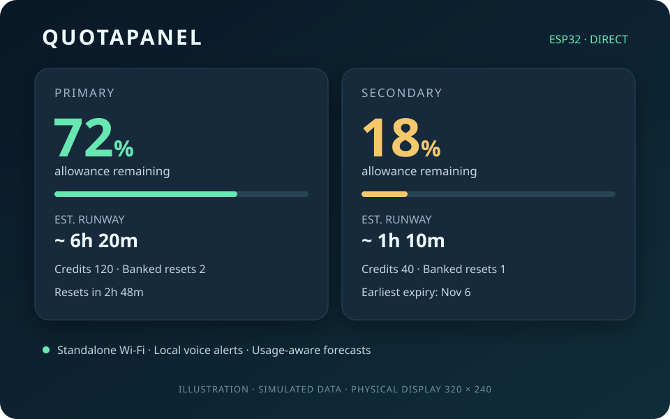

# QuotaPanel ESP32

A standalone desk display for two ChatGPT/Codex accounts: allowance, credits, banked resets, expiration dates, reset countdowns, usage forecasts, and offline voice alerts.

**Experimental alpha.** Tested on one ESP32-S3 board variant. Uses internal OpenAI account endpoints that may change. Independent project; not affiliated with OpenAI or the separate QuotaPanel desktop application.



*Illustration with simulated data; the physical screen is 320 × 240 pixels.*

## What it does

- Reads both accounts directly over verified HTTPS. No running Mac, PC, Raspberry Pi, or cloud bridge is required.
- Updates on a 30-second polling cycle and animates countdowns every second.
- Shows remaining included allowance, subscription credits, banked reset count, and earliest returned expiration.
- Estimates time until included allowance is exhausted using recent and historical consumption. Shows confidence and a sensitivity range; estimates are conditional on future usage continuing at a similar pace.
- Announces 10%, 5%, exhaustion, detected resets, inferred banked-reset use, and newly gained resets. Speech and chimes are embedded and work offline.
- Keeps history and warning latches through reboot. Boots with sound on at the saved volume. Tap the speaker to mute until reboot; hold BOOT for 1.5 seconds to toggle sound.

Credits are subscription/Codex credits, **not dollars or OpenAI API billing credits**. The firmware does not buy credits, redeem resets, send prompts, or run models.

## Hardware

The tested unit was purchased from [this AliExpress listing](https://www.aliexpress.us/item/3256810103745462.html). It is an ES3C28P-class 2.8-inch module with ESP32-S3, 16 MiB flash, 8 MiB PSRAM, an ILI9341 screen, FT6336 touch, and an ES8311 speaker codec.

A seller listing may offer several variants. Check the [verified pinout and hardware notes](docs/HARDWARE.md) before flashing. This is not a generic firmware image for every ESP32 display.

## Quick start

Use Python 3.11+ on macOS, Linux, or Windows. Setup needs a USB data connection and a browser; normal operation needs only power and 2.4 GHz Wi-Fi with Internet access. Two accounts are required by this alpha.

```sh
python3 -m venv .venv
# macOS/Linux:
source .venv/bin/activate
# Windows PowerShell: .venv\Scripts\Activate.ps1
python -m pip install -r requirements.txt
python tools/quotapanel.py ports
```

1. **Back up and flash.** Download the firmware bundle from Releases, or [build it locally](docs/BUILD.md). The flash tool validates the bundle, checks the chip/flash size, and creates a verified full backup before writing:

   ```sh
   python tools/flash.py --port YOUR_PORT flash PATH_TO_BUNDLE --backup .local/before-quotapanel
   ```

   Backups can contain Wi-Fi and account credentials. Keep them private. Do not attach them to issues.

2. **Set Wi-Fi and timezone.** The password is prompted without echo and is not stored on the computer:

   ```sh
   python tools/quotapanel.py --port YOUR_PORT configure --timezone UTC0
   ```

   For US Eastern time with daylight saving, use `EST5EDT,M3.2.0,M11.1.0`. See [setup and recovery](docs/SETUP.md).

3. **Pair each account through browser OAuth.** Complete the passkey/security-key prompt if your account requires it. Use a private browser window or switch accounts for the second account. `--no-browser` prints the link without opening it.

   ```sh
   python tools/quotapanel.py --port YOUR_PORT pair --account 1
   python tools/quotapanel.py --port YOUR_PORT pair --account 2 --no-browser
   python tools/quotapanel.py --port YOUR_PORT enable
   ```

   The board generates PKCE and state, exchanges the authorization code, and owns the tokens. The setup computer only forwards a one-time loopback callback. No existing Codex installation or profile is required.

4. **Check the result.** The footer should say DIRECT. You can now power the board from a USB charger.

   ```sh
   python tools/quotapanel.py --port YOUR_PORT status
   ```

## Controls

| Action | Result |
| --- | --- |
| Tap an account | Details, exact expiration date, forecast range |
| Tap the upper-left corner | Return to overview |
| Tap the right side of details | Cycle available allowance windows |
| Short BOOT press | Cycle overview / account 1 / account 2 |
| Hold BOOT 1.5 seconds, or tap speaker | Mute/unmute |
| `volume 25` | Set persistent volume (0–100) |
| `alert warning_5 --account 2` | Play a local demo; does not change account data |

## Before relying on it

This alpha uses the internal `/backend-api/wham/usage` and `/backend-api/wham/rate-limit-reset-credits` interfaces and Codex's public native OAuth client flow. These are not a supported third-party subscription API contract. Authentication or response changes can require firmware maintenance.

Tokens are stored in device flash. **Flash encryption and secure boot are not enabled.** Physical access can expose credentials. An interrupted or ambiguous token rotation requires a fresh browser login; the firmware does not risk replaying an uncertain refresh token. See [security](SECURITY.md).

The display defaults to the flipped landscape orientation (180° from alpha.2), with matching touch coordinates. After a brief reboot, saved history continues the forecast. After a longer gap, a recent saved trend can appear as `HISTORY` / `PAST` with low confidence until fresh observations establish the current pace. Trends older than six hours are not used for this fallback.

Banked-reset use is inferred from correlated count/usage changes, with known expirations suppressed. The server provides no redemption event stream. Forecast ranges are sensitivity bounds, not calibrated probabilities. Credit balances and banked resets are not converted into extra runway. Details are in [architecture and estimation](docs/ARCHITECTURE.md).

## Release status and roadmap

See [release readiness](docs/RELEASE_READINESS.md) for completed checks and limits. This is an alpha, not a claim of weeks-long unattended reliability.

Priorities after the first alpha: longer soak testing and interrupted-power coverage, one-account operation and custom labels, an on-device reauthorization flow, optional deployment-time flash encryption, and additional providers through explicit adapters. Bluetooth, microphone, battery telemetry, and SD features are not enabled merely because the board has them.

## Development

```sh
python -m unittest discover -s tests -v
python -m platformio run -d firmware
python tools/package_release.py
```

[Contributing](CONTRIBUTING.md) · [Security reports](SECURITY.md) · [Changelog](CHANGELOG.md) · [Build and licensing details](docs/BUILD.md)

Project code is GPL-3.0-only, except files with their own notices. The compact ES8311 adapter is Apache-2.0; generated speech assets are CC0-1.0. See [dependency notices](licenses/NOTICE.md). No Apple system-voice recordings, emulator ROMs, operating-system images, personal backups, or account data are distributed.

## Wi-Fi firmware updates

Alpha.4 adds signed, authenticated updates over encrypted local Wi-Fi, with inactive-slot writes and bootloader rollback. One USB migration and pairing is needed; future updates use `tools/wifi_update.py upload` and a signed `.qpu` release asset. The device profile stays private and no runtime bridge is required. See [setup, security and recovery](docs/WIFI_UPDATES.md).
