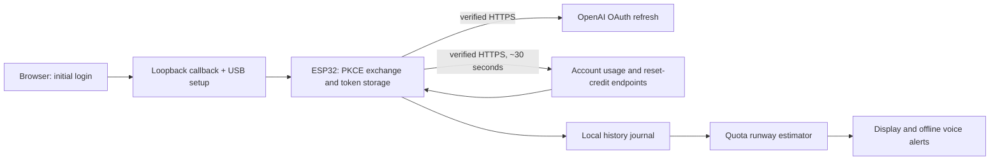

# Architecture and estimation

There is no runtime bridge or hosted application. A FreeRTOS worker serializes account network operations and authentication commands. The display remains responsive while it runs. A normal cycle fetches usage and reset-credit data for each account. Failures use bounded exponential backoff and honor Retry-After. On-screen freshness matters: a live countdown does not mean the server reading is new.

## Authentication and storage

TLS certificate chains, hostname and validity are checked using a full Mozilla/certifi root bundle. A fresh SNTP synchronization is required after every boot before HTTPS, even if the RTC already contains a plausible date. The OAuth flow uses PKCE S256 and random state with the public Codex native client, a fixed loopback callback, and board-owned refresh tokens. Browser setup does not read a local Codex profile. Tokens and Wi-Fi settings are in unencrypted NVS; see SECURITY.md.

Refresh runs before token expiry or after an HTTP 401. Before submitting a rotating refresh token, the firmware records a pending marker. A crash or ambiguous outcome causes reauthorization instead of reusing an uncertain token. A connection failure returned before HTTP headers or body are sent clears the pending marker after verified persistence and permits a later retry; send/read failures remain ambiguous. This trades availability for avoiding destructive rotation retries.

Flash layout: settings NVS at 0x9000 (20 KiB), factory application at 0x10000 (2 MiB), accounts NVS at 0x210000 (64 KiB), history at 0x220000 (64 KiB). The remainder of 16 MiB is unused by this application. Updating those application regions does not scrub old data elsewhere. There is no OTA partition in this alpha.

The journal retains the original 32-byte record layout and 64 KiB partition so upgrades preserve saved history. It verifies checksums and write readback, checkpoints every five minutes, saves changes of at least one percentage point at most once per minute, and saves resets/decreases immediately. A sudden power loss can lose up to five minutes of observations. Reboot recovery ignores corrupt/torn records; occupied partial records cause the next append to move to a fresh sector. The ring erases the oldest sector when full and handles sequence-number rollover. Its checksum detects accidental corruption, not tampering. Flash errors leave live observations usable, trigger retries on later polls, and surface as `historyHealthy: false` and a details-screen warning. Warning baselines persist separately. Fine-grained live history uses PSRAM; the forecast considers at most 24 hours, subject to the shared journal capacity and number of windows.

## Runway estimate

The model measures allowance percentage points, not tokens or money. Each allowance window is tracked independently for each account and reset epoch. The earliest relevant limiting window determines the account summary.

1. Reject invalid readings, deduplicate timestamps, and restrict history to the last 24 hours.
2. Start a fresh segment after a decrease in used allowance, a reset/correction, or an unobserved gap over 10 minutes. A latest reading older than 90 seconds is stale.
3. Require at least 10 minutes and two percentage points of observed consumption. An hour with less than one point consumed is reported as no recent burn.
4. Estimate rates over 15 minutes, 1 hour, 6 hours and 24 hours, weighted 55%, 30%, 10%, 5%. Down-weight incomplete windows and avoid duplicate baselines. Once the segment has two points of evidence, include zero/one-point recent horizons so a slowdown reduces the burn rate; their quantization uncertainty may leave the upper runway bound unknown.
5. Divide remaining allowance by the weighted rate. Bound the result using disagreement between horizons and a one-point endpoint quantization allowance. Bounds are sensitivity ranges, not statistical confidence intervals.
6. After a gap, require a fresh current reading but allow a usable prior segment from the same account/window/reset epoch, no older than six hours, while the new segment learns. Apply its rate to the **current** remaining allowance; never turn an unobserved jump into an instantaneous burn rate. Label this `HISTORY` / `PAST`, force low confidence, and widen its sensitivity bounds by `1 + age_in_hours`. A decrease clears all earlier slopes, even across a gap. One hour of observed quiet returns “no recent burn” instead of reviving a past busy period. These age limits and bounds are conservative heuristics, not measured prediction probabilities.
7. Confidence rises only with longer history, more consumed allowance, agreement between rates, and a forecast not too far beyond the observed history. Compare the range and point estimate with the scheduled reset to indicate when a reset may arrive first.

This responds to a new workload faster than a lifetime average without pretending that quantized quota reports are precise telemetry. It cannot predict future workload choices, changed server limits, or credits-to-usage conversion. Credits and banked resets are shown separately, not added to the runway. Accuracy has been checked through deterministic cases and C++/Python parity, not a calibrated real-world forecasting study.

The LCD and touch mapping both default to the landscape orientation rotated 180° from alpha.2. Every boot starts unmuted; mute is session-only. Volume and alert warning latches remain persistent, so rebooting does not replay an already delivered threshold warning.

## Alerts and bank expiration

Thresholds trigger on crossing 10% or 5%, with per-window latches that rearm for a new allowance cycle. A jump past both announces the more urgent threshold. Exhaustion, reset and bank events take precedence as appropriate. Startup observations establish a baseline instead of treating every existing state as a new event.

A bank-count decrease alone can mean expiration. A 'banked reset used' alert requires a correlated allowance restoration and is suppressed when the previously known expiration has passed. Gains and reset changes are detected from successive observations. These are conservative inferences, not a server event stream. Earliest expiration is the minimum usable expiration returned by the reset-credit endpoint; unknown values remain unknown.

Speech clips and chimes are local. The ES8311 adapter configures output only; no microphone or cloud speech service is used.

## Connection recovery

Version 0.1.0-alpha.1 trusted only ISRG roots. After a server certificate rotation to Google Trust Services, Wi-Fi and authentication discovery still worked but usage requests failed TLS. Version 0.1.0-alpha.2 embeds the pinned Mozilla/certifi trust store as full PEM certificates (118 roots, about 175 KiB), with TLS allocations in PSRAM, rather than depending on one certificate authority. Hostname and trust checks remain enabled. Because the pinned Arduino SDK was compiled without certificate-date checks, the TLS adapter repeats standard mbedTLS chain verification with an explicit UTC validity callback before allowing HTTP headers or credentials to be sent. Expired and not-yet-valid certificates are rejected, and no verification flags are cleared. The older Arduino compact-bundle callback fails when the server sends a cross-signed root whose parent has left the trust store, even if the root itself is trusted. Full certificates let the standard mbedTLS path builder terminate at the trusted root without reintroducing the retired parent.

Failures retry after 5, 15, 30, 60, 120 and then 300 seconds, respecting a longer numeric Retry-After up to an hour. A Wi-Fi reconnection clears the backoff so polling resumes promptly. Clock synchronization retries independently. Each account reports its own error, a successful account stays usable when the other fails, and the dashboard shows an automatic retry countdown instead of reporting LIVE for failed fetches.

The trust store is bundled with firmware, not downloaded without verification at runtime. Ordinary leaf/intermediate/CA-chain rotation within the Mozilla store works without re-pairing; new or distrusted roots still require a firmware update. See BUILD.md for regeneration and provenance.
